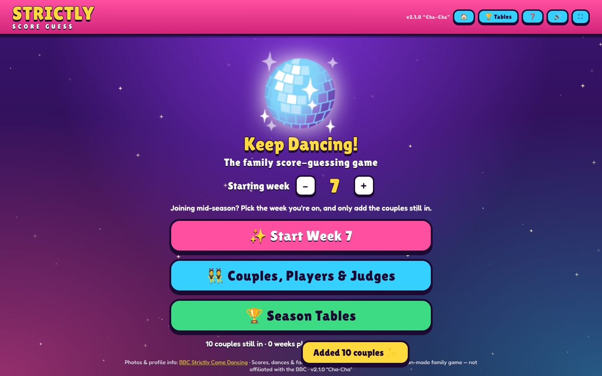
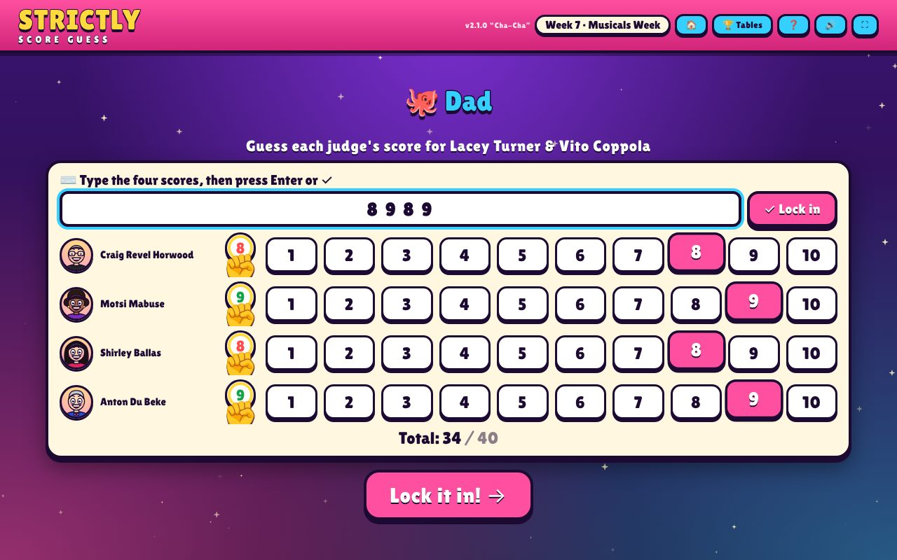
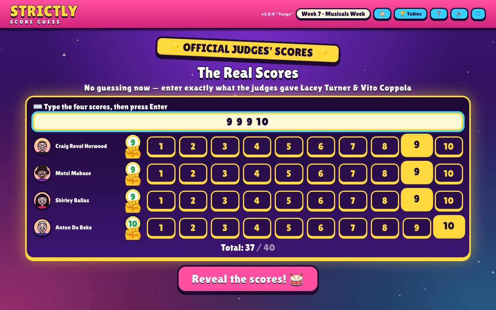
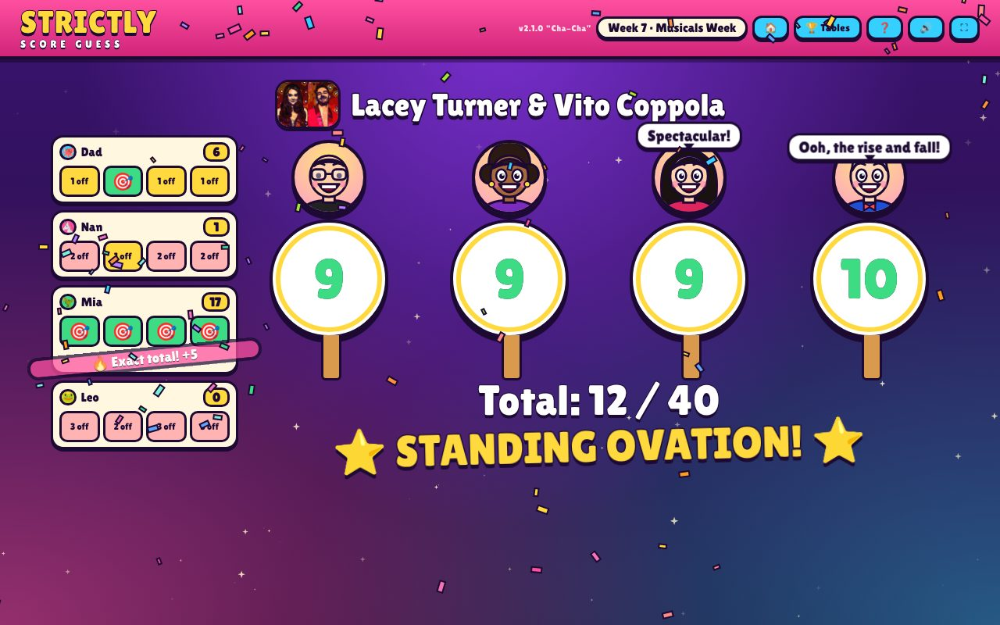
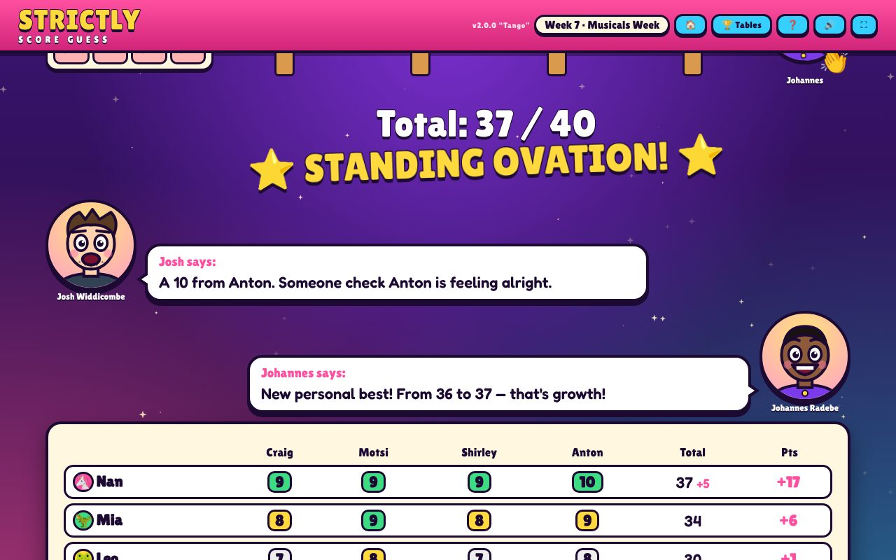
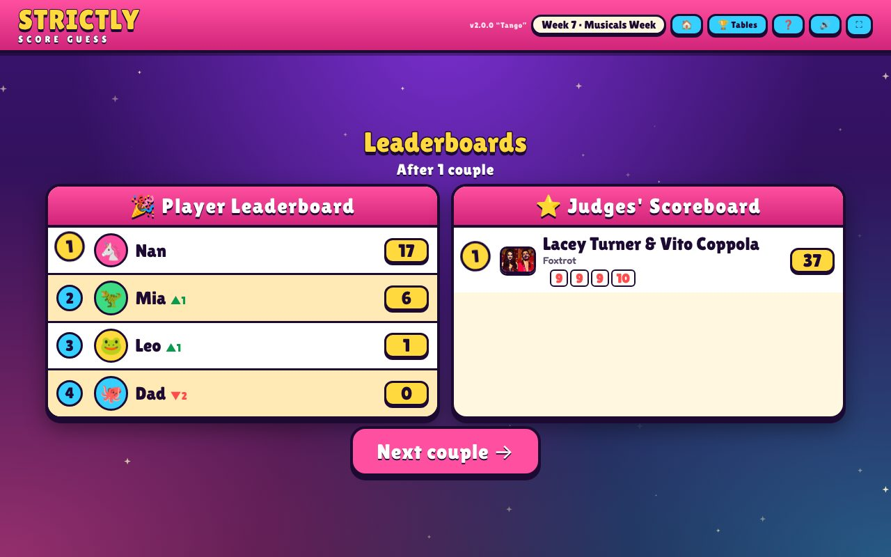

# Keep Dancing! 🪩

*The Strictly score-guessing game.*

A family game to play while watching Strictly Come Dancing. Guess each judge's score before they give it!

- Runs entirely in the browser; progress is saved in `localStorage` (resume any time in the same browser).
- Remembers couples week to week; mark couples as sick/absent for a week and pick who left at the end.
- Season tables for players and couples. Export/import a backup from the "Couples, Players & Judges" screen.

## Play / host on GitHub Pages
1. Merge to `main`.
2. Repo **Settings → Pages → Build and deployment → Deploy from a branch → `main` / `(root)`**.
3. Open `https://<your-user>.github.io/strictly-game/`.

Or just open `index.html` in a browser.


## Screenshots

| | |
|---|---|
|  **Keep dancing!** Load the 2026 couples in one tap |  **Who's up next?** No running order needed |
|  **Curtains up**: cartoon couples, the week's theme and "Did you know?" facts |  **Guess the paddles**: type `8 9 8 9` and press Enter |
|  **The official scores**: enter each judge, confirm, and up goes the paddle |  **The reveal**: everyone's 🎯 or "2 off" lands live as each paddle goes up, with the odd "Fab-u-lous!" |
|  **Presenter banter** using real series stats (Josh is always snarky) |  **Leaderboards** for the family and the judges |

## Analytics (optional, cookieless)
The game ships with analytics switched off. To turn on a cookieless tracker (Plausible, Umami, Simple Analytics, GoatCounter…), set the `ANALYTICS` constant near the top of the script in `index.html`, for example:

```js
const ANALYTICS={src:'https://plausible.io/js/script.js',attrs:{'data-domain':'natm.github.io/strictly-game'}};
```

The game then also sends three anonymous events, `week_started`, `couple_revealed` and `week_finished`, to whichever tracker is loaded. They include the week number and player count, but never names or scores. No cookies are set either way.

## Routines
`routines/` holds instructions Claude can run on a schedule. For example, `update-series-data.md` pulls the latest scores from Wikipedia and then tests, releases and deploys. See [routines/README.md](routines/README.md).

## Releases
Each release has a semantic version and a dance name (e.g. `v2.0.0 "Tango"`), shown in the game header and footer.
To release: bump `VERSION`/`RELEASE` in `index.html`, add a section to `CHANGELOG.md`, and deploy to the `gh-pages` branch.
The `release` workflow then creates the `vX.Y.Z` tag and GitHub release with the changelog notes (pushing a `v*` tag by hand works too).

## Credits
Photos and profile info: BBC Strictly Come Dancing. Scores, dances and facts: Wikipedia (CC BY-SA).
This is an unofficial fan-made family game and is not affiliated with the BBC.
